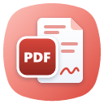

<p align="center">
  
</p>

<h1 align="center">UniPDF</h1>

<p align="center">
  O leitor e editor de PDF da <b>Uniphar Indústria Farmacêutica</b>.
</p>

<p align="center">
  <a href="https://github.com/uaidenys/unipdf/releases/latest"><b>Baixar a versão mais recente</b></a>
</p>

---

## O que ele faz

- **Ler:** abre qualquer PDF com rapidez, mesmo arquivos grandes ou danificados; zoom nítido,
  modos de leitura, tela cheia e tema claro ou escuro.
- **Encontrar:** busca no texto, marcadores, miniaturas e navegação por páginas.
- **Organizar:** girar, apagar, inserir, mover, juntar e dividir páginas, com desfazer.
- **Comentar e preencher:** comentários, destaques, carimbos, formulários e anexos.
- **Converter:** exportar para Word e Excel, criar PDF a partir de imagens e ler texto de páginas
  escaneadas (OCR do Windows).
- **Proteger:** senhas e permissões, ocultação definitiva de conteúdo (tarja) e otimização do
  tamanho do arquivo.
- **Assinar digitalmente:** com certificado A1 ou A3 instalado no Windows. Com certificado
  ICP-Brasil, há a opção **"Padrão ICP-Brasil (política AD-RB)"**, que acrescenta a política de
  assinatura conferida pelo ITI. A assinatura comum continua disponível.
- **Validar no ITI:** o painel Assinaturas tem o botão **Validar no ITI**, que abre o
  [validar.iti.gov.br](https://validar.iti.gov.br/) e mostra o arquivo para arrastar até lá. O
  UniPDF não envia documentos para lugar nenhum por conta própria.
- **Privado:** os documentos ficam no computador, sem conta e sem nuvem.

## Como instalar

- **Pelo Uni Launcher (recomendado):** instale o
  [Uni Launcher](https://github.com/uaidenys/uni-launcher/releases/latest) e clique em instalar no
  UniPDF. O launcher também cuida das atualizações.
- **Direto:** na [página da versão mais recente](https://github.com/uaidenys/unipdf/releases/latest),
  em **Assets**, baixe o arquivo `-windows-x64.msi` e abra. Se o Windows mostrar "O Windows protegeu
  o computador", clique em **Mais informações › Executar assim mesmo**. O instalador ainda não tem
  assinatura digital de código.

Requisitos: Windows 10 ou 11, 64 bits.

## Para desenvolvedores

O UniPDF é feito em Rust, com [egui](https://github.com/emilk/egui).

```bash
cargo run --release -p pdfcraft
```

Para gerar o instalador do Windows (precisa do [WiX v5](https://wixtoolset.org)):

```powershell
powershell -ExecutionPolicy Bypass -File packaging/windows/package.ps1 -Arch x64 -SkipModels
```

`-SkipModels` gera o pacote sem os modelos de OCR do projeto original, cujo download não está mais
disponível; no Windows o UniPDF usa o OCR do próprio sistema. O arquivo sai em `dist/release/`. Os
nomes internos `pdfcraft` foram mantidos do projeto original; o Uni Launcher reconhece os dois nomes.

A ferramenta de linha de comando `pdfcraft-cli` e o servidor MCP permitem automatizar o app; a
documentação técnica está em [docs/](docs/).

## Licença e créditos

- **Código:** MIT ou Apache-2.0, à sua escolha ([LICENSE-MIT](LICENSE-MIT),
  [LICENSE-APACHE](LICENSE-APACHE)). Avisos obrigatórios em [NOTICE](NOTICE).
- **Marca:** os nomes Uni e Uniphar, o ícone e as imagens da animação de abertura pertencem à
  Uniphar Indústria Farmacêutica e **não** estão cobertos pela licença do código. Termos em
  [docs/brand/LICENSE-brand.txt](docs/brand/LICENSE-brand.txt). Quem fizer uma versão modificada
  precisa usar nome e identidade visual próprios.
- **Materiais de terceiros:** fontes, ícones e outros arquivos com suas licenças, listados em
  [ATTRIBUTION.md](ATTRIBUTION.md).

O UniPDF é uma versão modificada do [PdfCraft](https://github.com/storytold/pdfcraft), criado pela
equipe ArtCraft e colaboradores (MIT OR Apache-2.0).

Desenvolvido por Denys Rodrigues de Oliveira para a Uniphar Indústria Farmacêutica ·
[uniphar.com.br](https://uniphar.com.br/)
